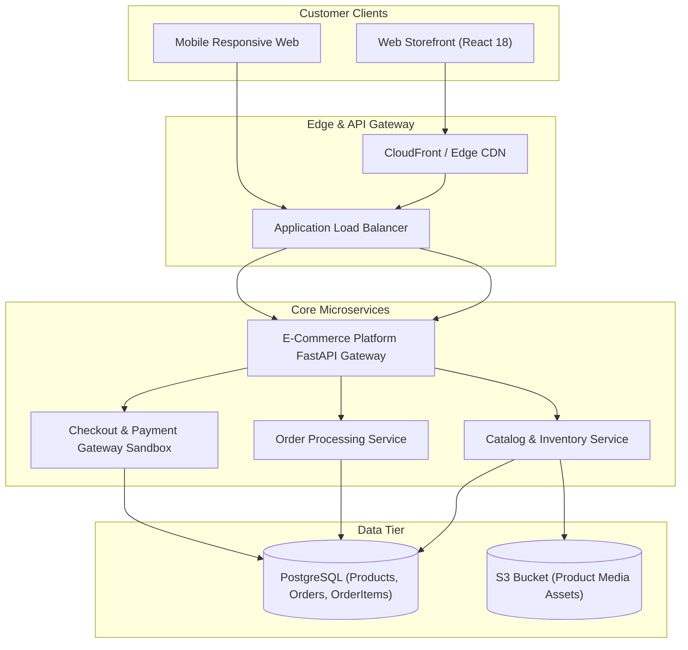

# E-Commerce Platform

Production cloud microservice generated by **AI Product Architect**.

## Domain Overview
- **Domain Category**: E-Commerce & Order Management Platform
- **Description**: Scalable digital commerce engine with product catalog, cart, and payment checkout sandbox.
- **Primary Entity**: `Product`
- **Entities**: `User`, `Product`, `Order`, `OrderItem`

## Architecture Specification
- **Compute**: AWS ECS Fargate
- **Database**: PostgreSQL 15 RDS Multi-AZ
- **Cache**: None (catalog indexed directly in Postgres)
- **Security**: JWT OAuth2 Bearer Tokens, Bcrypt Password Hashing, CORS Guards

## Architecture Topology


## Quick Start
```bash
# 1. Run local multi-container environment
docker-compose up --build

# 2. Check Service Health
curl http://localhost:8000/health
```

## API Documentation
- Interactive Swagger UI: `http://localhost:8000/docs`
- Live Deployment Preview: `http://localhost:8000/preview/e-commerce-platform`
