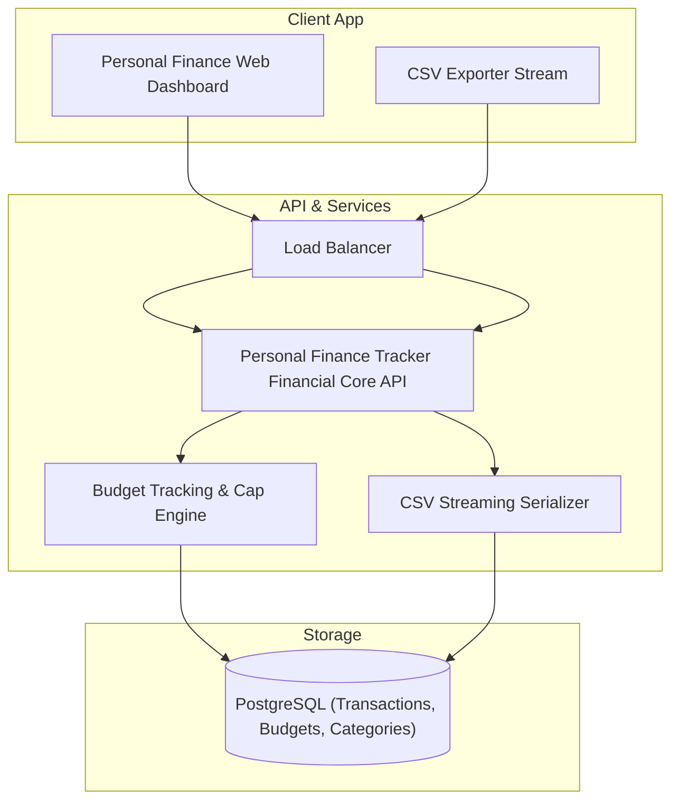

# Personal Finance Tracker

Production cloud microservice generated by **AI Product Architect**.

## Domain Overview
- **Domain Category**: Personal Finance & Expense Tracker
- **Description**: Personal finance tracker managing transactions, monthly category budgets, and CSV export.
- **Primary Entity**: `Transaction`
- **Entities**: `User`, `Category`, `Transaction`, `Budget`

## Architecture Specification
- **Compute**: AWS ECS Fargate
- **Database**: PostgreSQL 15 RDS with Numeric Precisions
- **Cache**: None
- **Security**: JWT OAuth2 Bearer Tokens, Bcrypt Password Hashing, CORS Guards

## Architecture Topology


## Quick Start
```bash
# 1. Run local multi-container environment
docker-compose up --build

# 2. Check Service Health
curl http://localhost:8000/health
```

## API Documentation
- Interactive Swagger UI: `http://localhost:8000/docs`
- Live Deployment Preview: `http://localhost:8000/preview/personal-finance-tracker`
