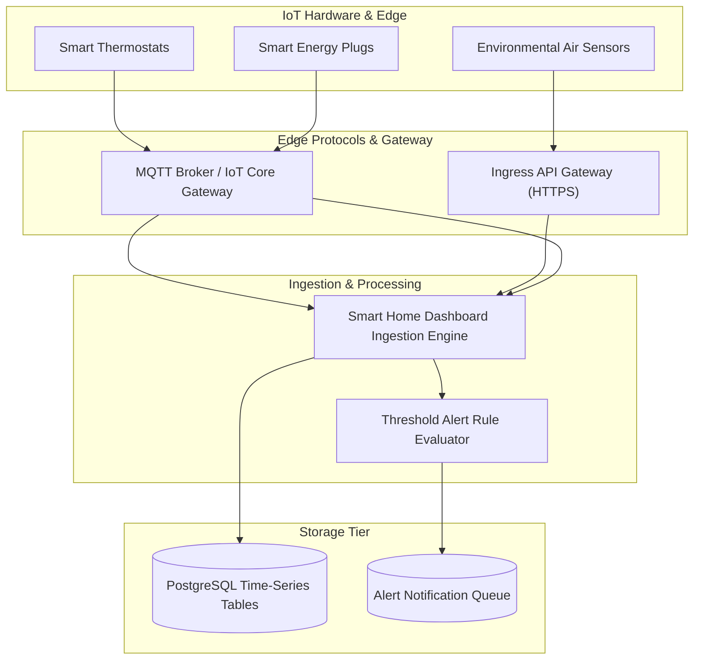

# Smart Home Dashboard

Production cloud microservice generated by **AI Product Architect**.

## Domain Overview
- **Domain Category**: Smart Home IoT & Telemetry Platform
- **Description**: Smart home telemetry hub managing device registrations, live sensor streams, and threshold alerts.
- **Primary Entity**: `Device`
- **Entities**: `User`, `Device`, `SensorReading`, `AlertRule`

## Architecture Specification
- **Compute**: AWS ECS Fargate Ingestion Workers
- **Database**: PostgreSQL 15 with Time-Series B-tree Indexes
- **Cache**: None (direct indexing with time buckets)
- **Security**: JWT OAuth2 Bearer Tokens, Bcrypt Password Hashing, CORS Guards

## Architecture Topology


## Quick Start
```bash
# 1. Run local multi-container environment
docker-compose up --build

# 2. Check Service Health
curl http://localhost:8000/health
```

## API Documentation
- Interactive Swagger UI: `http://localhost:8000/docs`
- Live Deployment Preview: `http://localhost:8000/preview/smart-home-dashboard`
