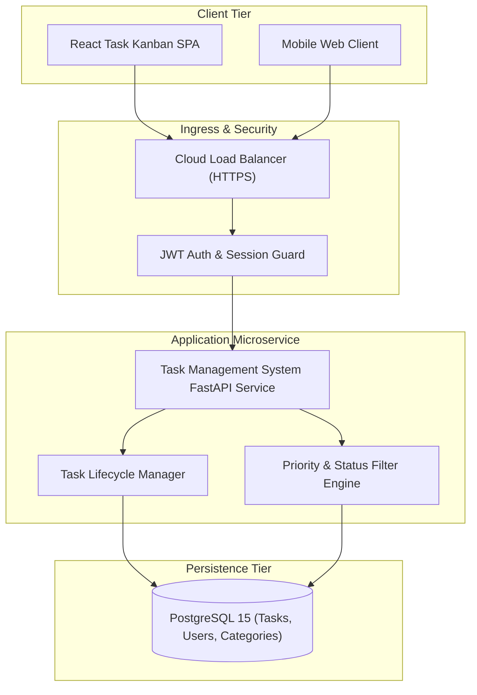

# Task Management System

Production cloud microservice generated by **AI Product Architect**.

## Domain Overview
- **Domain Category**: Task Management Application
- **Description**: Comprehensive collaborative task, priority, and deadline tracking platform.
- **Primary Entity**: `Task`
- **Entities**: `User`, `Task`, `Category`

## Architecture Specification
- **Compute**: AWS ECS Fargate / Cloud Run
- **Database**: PostgreSQL 15 (RDS)
- **Cache**: None (unnecessary for standard task CRUD)
- **Security**: JWT OAuth2 Bearer Tokens, Bcrypt Password Hashing, CORS Guards

## Architecture Topology


## Quick Start
```bash
# 1. Run local multi-container environment
docker-compose up --build

# 2. Check Service Health
curl http://localhost:8000/health
```

## API Documentation
- Interactive Swagger UI: `http://localhost:8000/docs`
- Live Deployment Preview: `http://localhost:8000/preview/task-management-system`
